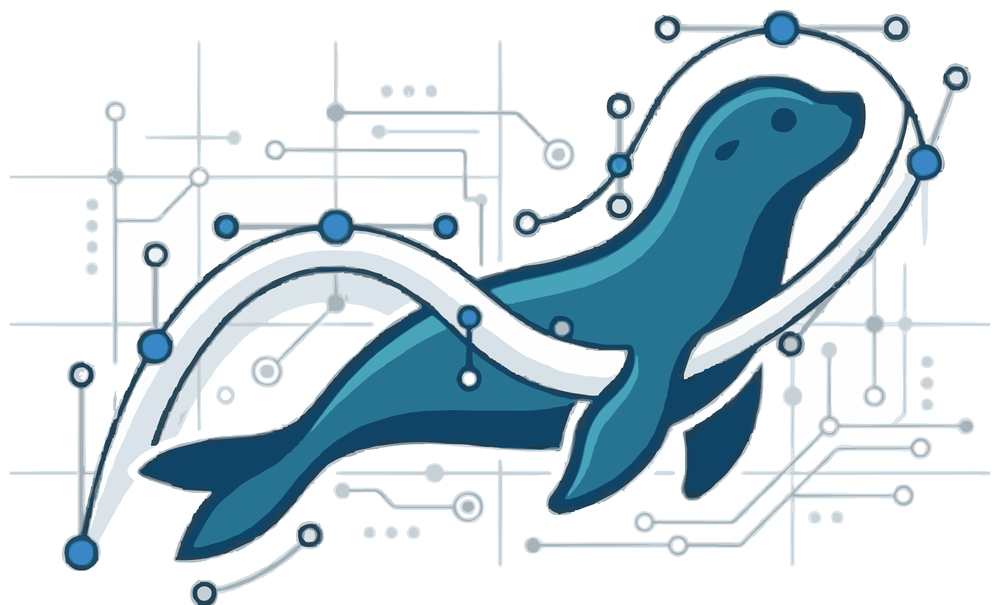

# NerpaCad



**Alpha 0.1** · лицензия GPL-3.0

Простая настольная программа для детей и школ для 3D-моделирования в стиле TinkerCad: фигуры собираются на рабочей плоскости, любая фигура может стать «отверстием», а группировка вырезает отверстия из тел. Готовая модель экспортируется в STL для 3D-печати.

Интерфейс на русском, английском и китайском (упрощённом) — выпадающий список языков в правом верхнем углу.

Четыре цветовые темы (кнопка с палитрой рядом со списком языков): «Киберпанк» в духе Cyberpunk 2077 и три темы по палитрам Canva «100 цветовых сочетаний» — «Пустыня», «Морская волна», «Индустриальная строгость». Тема меняет интерфейс, 3D-сцену и цвета новых фигур; выбор запоминается.

## Запуск

Нужен **Node.js 22.12 или новее** (LTS): https://nodejs.org

Откройте терминал (PowerShell) в этой папке и выполните:

```
npm install
npm run dev
```

`npm install` один раз скачивает все библиотеки и сам Electron (около 200 МБ). `npm run dev` запускает программу; при правке исходников она перезагружается сама.

## Установщики (Windows и Linux)

| Система | Файл | Как собрать |
|---|---|---|
| Windows 10/11 (64 бит) | `NerpaCad-0.1.0-alpha-win-x64.exe` | `npm run build:win` (на Windows) |
| Linux: любой дистрибутив | `NerpaCad-0.1.0-alpha-linux-x86_64.AppImage` | `npm run build:linux` (на Linux) |
| Linux: Ubuntu, Debian, Mint | `NerpaCad-0.1.0-alpha-linux-amd64.deb` | там же |

Готовые файлы появляются в папке `dist`.

**Windows.** Установщик спрашивает папку (по умолчанию — только для текущего пользователя, права администратора не нужны), показывает лицензию GPL, создаёт ярлыки на рабочем столе и в «Пуске», связывает файлы `.nerpa` (и старые `.tcad`) с программой; удаляется через «Параметры → Приложения». Установщик пока без цифровой подписи, поэтому Windows покажет «Windows защитила ваш компьютер»: нажмите «Подробнее» → «Выполнить в любом случае».

**Linux, .deb.** `sudo apt install ./NerpaCad-0.1.0-alpha-linux-amd64.deb` (или двойной клик в менеджере пакетов). Программа появится в меню в разделе «Образование», файлы `.nerpa` открываются двойным кликом. Для Ubuntu 24.04 и новее пакет сам ставит профиль AppArmor, чтобы работала песочница Chromium. Удаление: `sudo apt remove nerpacad`.

**Linux, AppImage.** Один файл без установки: `chmod +x NerpaCad-*.AppImage` и запуск двойным кликом. Нужен FUSE (`sudo apt install libfuse2` на Ubuntu 22.04+; без него — `./NerpaCad-*.AppImage --appimage-extract-and-run`). На системах, где AppArmor не даёт песочнице запуститься (Ubuntu 24.04+), AppImage сам запускается без неё.

Автообновления в альфе нет. Проверка собранной программы: `PACKAGED_BIN=/opt/NerpaCad/nerpacad npx playwright test tests/e2e/packaged.spec.ts` (или путь к AppImage).

## Что умеет

| | |
|---|---|
| Фигуры | куб, цилиндр, сфера, полусфера, конус, пирамида, клин, круглая кровля, многоугольник (призма, 3–24 стороны), икосаэдр (лежит на грани — печатается без поддержек), тор, 3D-текст (кириллица поддерживается) |
| Параметрические | детали для печати, которые настраиваются числами в свойствах (размер задают параметры, а не растягивание): **шестерёнка** (зубья, модуль, толщина, отверстие; две шестерёнки одного модуля сцепляются на расстоянии (Ø1 + Ø2) / 2); **винт** (резьба M6–M24 с шагом по ISO, длина, головка шестигранная, круглая, потайная или без головки) и **гайка** (шестигранная, барашек, рифлёная) — у обоих есть «зазор», чтобы напечатанные детали свинчивались; **банка с крышкой** на резьбе (добавляется сразу парой); **зубчатая рейка** под шестерёнку того же модуля; **колесо** (канавка под резинку, окна, отверстие круглое или с лыской под вал мотора); **шкив** под круглый или клиновой ремень; **шайба / втулка**; **пружина** (диаметр, виток, шаг, число витков, плоские торцы); **коробка с крышкой** (надевающейся или сдвижной, тоже парой); **петля**, которая печатается сразу собранной; **ручка под гайку** (звезда или рифлёная, с гнездом под гайку и отверстием под винт); **брелок** с выпуклой надписью. Резьба — настоящая винтовая (сечение, закрученное на виток за шаг), правая. |
| Материалы | обычный, светящийся, прозрачный (в панели свойств); влияют только на вид, в STL/OBJ не попадают |
| Симметрия | кнопки ⇋ZY и ⇋ZX слева: у каждой фигуры появляется связанный зеркальный двойник, всё, что делаете с фигурой или двойником, повторяется зеркально; удаление удаляет пару; фигура в центре плоскости двойника не получает; выключили — двойники остаются обычными фигурами. Сгруппируйте фигуру с её двойником — получится симметричная деталь |
| Добавление | потянуть фигуру с панели — её полупрозрачная копия следует за курсором и встаёт на плоскость или на верх другой фигуры; либо просто нажать на плитку |
| Ручки | жёлтые квадраты в углах — ширина и глубина; бирюзовые на сторонах — одна сторона; жёлтый сверху — высота; красный конус — поднять над плоскостью; изогнутые стрелки — поворот (во время поворота показывается транспортир с делениями) |
| Точный ввод | размер, положение и поворот в панели свойств; число граней у круглых фигур; текст надписи |
| Отверстия | кнопка «Отверстие» (или клавиша H) в панели свойств, затем «Сгруппировать» |
| Группы | Ctrl+G — сгруппировать, Ctrl+Shift+G — разгруппировать; группы можно вкладывать |
| Правка | отмена и повтор, копирование, вставка, дублирование, удаление, выравнивание, отражение, «опустить на плоскость» |
| Сетка | шаг привязки от 0,1 до 10 мм или выкл (внизу справа); плоскость полупрозрачная, снизу видно фигуры |
| Рабочая плоскость | клавиша W и клик по грани — плоскость встаёт на грань, новые фигуры ставятся на неё |
| Размеры и привязка | размеры у ручек (клик по числу — ввести своё), высота над плоскостью, направляющие к краям и центрам соседних фигур |
| Линейка | клавиша R — расстояния от линейки до выделенной фигуры, их тоже можно вводить |
| Эскиз | кнопка «Эскиз» во вкладке «3D»: рисование на грани фигуры или на рабочей плоскости, привязки и размеры с настоящим решателем (как Sketcher во FreeCAD), выдавливание и тела вращения (фигура или отверстие), повторная правка двойным кликом, экспорт чертежа в DXF и SVG |
| Файлы | проект `.nerpa` (старые `.tcad` тоже открываются), экспорт STL и OBJ (всё или выделенное), импорт STL; файлы можно перетащить в окно |
| Автосохранение | пока в проекте есть несохранённые изменения, программа раз в минуту записывает его копию в свою служебную папку; если программа закрылась аварийно, при следующем запуске она предложит восстановить проект (он откроется как несохранённый — Ctrl+S запишет его в его файл, а если папки файла уже нет, спросит, куда сохранить). Если упало только окно программы, оно само перезапустится и сразу предложит восстановить работу. После сохранения или обычного закрытия копия удаляется; копия упавшего окна и копия, о которой ещё не ответили «Восстановить?», сохраняются |

## Управление

| Действие | Как |
|---|---|
| Выбрать, перетащить фигуру | левая кнопка мыши |
| Выделить рамкой | левая кнопка по пустому месту и потянуть |
| Добавить к выделению | Shift + клик |
| Вращать вид | правая кнопка мыши |
| Сдвигать вид | средняя кнопка или Shift + правая |
| Приближение | колесо мыши |
| Вид с нужной стороны | клик по грани куба в левом верхнем углу |
| Показать всё | F или двойной клик по пустому месту |
| Сдвиг на шаг сетки | стрелки (Shift — на 10 шагов), Ctrl + ↑ / ↓ — вверх и вниз |
| Пропорциональный масштаб | Shift при перетаскивании ручки |
| Поворот с шагом 1° | Shift при повороте (без Shift — шаг 22,5°) |
| Отменить перетаскивание | Esc |
| Справка | F1 |

## Эскиз

Вверху три вкладки: **3D**, **Робототехника**, **Схемотехника**. Эскиз — это функция вкладки «3D»: кнопка «Эскиз» на панели инструментов, пока идёт эскиз, превращается в «Готово». Справа у фигур две вкладки: «Основные» и «Параметрические» (фигуры, которые настраиваются числами). Слева под кнопками вида — переключатели плоскостей **ZY** (красная, поперёк оси X) и **ZX** (зелёная, поперёк оси Y); по умолчанию они скрыты.

1. Нажмите «Эскиз» на панели инструментов и кликните по грани фигуры (рисовать на ней), по включённой плоскости ZY или ZX (эскиз встанет вертикально, начало координат — в центре сцены) или по пустому месту (на рабочей плоскости). Камера повернётся прямо на плоскость. Фигуры, которые стоят перед плоскостью эскиза и загораживали бы её, на время эскиза становятся полупрозрачными.
2. Рисуйте: линия (L), прямоугольник (R) и прямоугольник от центра, окружность (O), дуга (A) и дуга по 3 точкам, многоугольник (N), точка. Варианты прямоугольника и дуги спрятаны за одной кнопкой: маленький треугольник в её углу открывает список, кнопка запоминает выбранный вариант. Ломаная замыкается кликом в первую точку; двойной клик, Enter или правая кнопка заканчивают её. Правая кнопка заканчивает (или отменяет недорисованную) фигуру, а когда ничего не рисуется — возвращает инструмент «Выбор». Точки сами прилипают к другим точкам, линиям, осям и сетке, почти горизонтальные и вертикальные линии выравниваются (Alt — без привязок). G — вспомогательная (пунктирная) геометрия.
3. Выбор (Q или Esc): точки и линии можно тянуть мышью, решатель сохраняет все привязки. «Обрезать» убирает кусок линии или окружности между пересечениями, «Скругление» закругляет угол между двумя линиями заданным радиусом; дугу скругления (или её концы) можно тянуть мышью — радиус меняется, и число в его размере обновляется само.
4. Привязки — выделите элементы и нажмите кнопку или клавишу: совместить (C), горизонтально (H), вертикально (V), параллельно (P), перпендикулярно (K), равные (E), касание (T), середина (M), симметрично, закрепить. Размер (D) сам понимает, что выделено: длина линии, диаметр окружности, радиус дуги, расстояние между точками или от точки до линии, угол между линиями. Есть размеры по X и по Y. Клик по числу размера — ввести новое значение; клик по стрелке или линии размера — выделить его (Delete удаляет только размер, линия остаётся). Диаметр по умолчанию выносится над окружностью (выносные линии касаются её краёв), так что центр окружности свободно перетаскивается. Размер можно перетащить за число или за линию — он запомнит место и будет двигаться вместе с чертежом.
5. Значки привязок показываются рядом с линиями и не наезжают друг на друга и на размеры (их можно скрыть галочкой «значки»; легенда — в справке F1). У правильного многоугольника один значок вместо десятков (клик выделяет все его привязки); равные линии получают по одному «=» с номером группы, касание дуги — значок в точке касания. Внизу панели видно, сколько осталось степеней свободы. Когда их 0, эскиз полностью определён и становится зелёным. Пока свобода ещё есть, уже закреплённые линии и точки тоже окрашены в «готовый» цвет, а то, что ещё можно сдвинуть, — обычным: сразу видно, чему не хватает размера или привязки. Противоречащая или лишняя привязка не принимается — появится подсказка.
6. «Готово» → «Выдавить»: высота, направление (вверх, вниз, в обе стороны) и что получится (тело или отверстие). Вложенный контур становится дыркой.
   Или «Вращать»: контур поворачивается вокруг оси, как на токарном станке, — так получаются вазы, колёса, кегли, шахматные фигуры. Ось — ось Y или X эскиза либо любая линия чертежа (удобно провести вспомогательную, клавиша G). Угол 360° даёт целое тело, меньше — его часть. Рисуйте контур с одной стороны оси. Совет: чтобы ваза стояла, начните эскиз на боковой грани куба или на вертикальной рабочей плоскости, либо после вращения нажмите D — фигура встанет на плоскость. Двойной клик по такой фигуре (или «Изменить эскиз» в свойствах) снова открывает эскиз.
7. Кнопки DXF и SVG сохраняют чертёж для станков, лазерной резки и других программ.


**Кривая (сплайн).** Инструмент «Кривая» (клавиша S): кликайте — через точки пройдёт плавная кривая. Клик в первую точку замыкает её, двойной клик, Enter или правая кнопка — заканчивают открытую кривую. Концы кривой можно соединять с линиями и дугами (общие точки), так получаются замкнутые контуры для выдавливания и вращения; замкнутая кривая — контур сама по себе. Точки кривой перетаскиваются, привязки и размеры ставятся на её точки; перетаскивание самой кривой сдвигает её целиком. «Обрезать» удаляет кривую целиком. В DXF кривая сохраняется короткими отрезками, в SVG — ломаной.

## Робототехника

Третья вкладка вверху — «Робототехника». Вместо рабочей плоскости появляется большой пол с сеткой 30 × 30 см.

Поле робототехники — **отдельная сцена** того же проекта: 3D-модель и поле не мешают друг другу, у каждой своё выделение, камера и шаг сетки, а в файле `.nerpa` хранятся обе. На поле размеры показываются **в сантиметрах** (в 3D — в миллиметрах); сами предметы при этом не масштабируются.

**Своя модель на поле.** Во вкладке «3D» выделите фигуры (или ничего — тогда вся модель) и нажмите «В симулятор»: они станут одним предметом на поле в натуральную величину, и откроется вкладка «Робототехника». Если снова отправить те же фигуры (например, после правки), предмет на поле обновится и останется на своём месте. Отмена (Ctrl+Z) возвращает и это.

1. **Трасса.** Перетащите тайлы (прямая, поворот, перекрёсток) на пол. Тайл 30 × 30 см, линия шириной 2 см; тайл встаёт в клетку сетки, R поворачивает выделенное на 90° (Shift+R — обратно).
   **Рельеф трассы.** Площадка (возвышение, по которому можно ездить), рампа (наклонный въезд, 1 или 2 клетки длиной) и мост (настил на высоте, под ним можно проехать — ставьте его между двумя площадками). Они тоже встают по сетке; R поворачивает на 90° (длинная рампа поворачивается вокруг своей верхней клетки). В свойствах — высота (3…30 см, по умолчанию 12: под мостом проходят и робот, и нерпа) и длина рампы. Тайлы трассы кладутся и на рельеф: на площадку и мост — сверху, на рампу — вдоль наклона. Тайл на клетке моста ложится на мост; «Где лежит тайл» в свойствах опускает его на пол под мостом. Рельеф строится **ярусами**: площадка, рампа или мост встаёт на самую высокую поверхность под собой — на пол, ландшафтную клетку (1 см) или верх другой площадки, — так что можно сделать площадку, на ней рампу, а дальше площадку повыше. Перетаскиваемый элемент держит свой ярус. Когда площадку делают выше, двигают или убирают, всё, что на ней стояло (и верхние ярусы тоже), следует за ней.
   Робот и нерпа заезжают по рампе (не круче ~25°: рампа 1 клетки длиной — до 14 см, 2 клетки — до 28 см), наклоняются на склоне, упираются в стенки площадок и падают с края. Датчик линии видит тайлы только на своём уровне (не мост над собой и не пол внизу), а над краем площадки читает 0 — как над чёрным; датчик касания срабатывает о стенку площадки, но не о подножие рампы, на которую робот въезжает.
   **Местность** (раздел «Местность», вкладки «Ландшафт / Рельеф / Декор»). Ландшафтные клетки 30 × 30 см: трава, песок, камень, дорога (на ней может быть чёрная линия — прямая, поворот или перекрёсток) и вода. Перетащите кнопку на клетку — тайл встанет туда (или заменит то, что там было), либо включите **кисть**: ведите с зажатой кнопкой мыши по полю, и клетки закрашиваются; мазок с **Shift** закрашивает прямоугольник, с **Ctrl** — прямую линию клеток (удобно для дороги); ластик стирает так же; весь мазок — один шаг отмены, Esc отменяет мазок или убирает кисть. Клетки под площадками и мостами кисть не трогает. Робот и Читик останавливаются у воды и в неё не заходят (даже блоком «перейти в»), нерпа в ней плавает. Если скопировать тайл на место (Ctrl+D) или перетащить на занятую клетку, он заменит прежний: на клетке всегда один тайл. **Декор** — дерево, ёлка, куст, валун, цветы: всё, кроме цветов, — препятствие (под кроной дерева робот и нерпа проходят, ствол их останавливает).
2. **Робот.** Это NerpaBot — собственный робот программы: два ведущих колеса, опорный шарик сзади и 5 площадок под датчики. Перетащите его на поле. Повернуть — R или стрелкой-ручкой, точный угол — в свойствах. Других роботов можно добавить модами (см. ниже «Моды»); тогда в панели у каждого своя карточка, а в свойствах робота можно сменить модель.
3. **Датчики и фонарик.** Пять устройств, у каждого свой цвет платы: датчик линии (зелёный), ультразвуковой дальномер (синий), датчик касания (красный), датчик света (жёлтый) и фонарик (оранжевый). Перетащите карточку на робота: у робота 5 площадок, при перетаскивании они подсвечиваются, и устройство «примагничивается» к ближайшей (жёлтая — сюда встанет, оранжевая — уже занята). Можно и проще: нажать на карточку (она выберется и встанет на первую свободную площадку), а потом нажимать на пустые площадки на схеме робота справа. Номер площадки — это порт в блоках.
   - **Датчик линии** — яркость пола: 0 — чёрное, 100 — белое, на краю линии около 50. Покрытия местности он видит разной яркостью: вода 20, трава 62, камень 68, песок 86, дорога 90 (чёрная линия на дороге — 0) — так можно запрограммировать «еду по дороге».
   - **Дальномер** — расстояние до ближайшего предмета впереди, 2…400 см (400 — впереди пусто). Видит предметы, других роботов и нерп, но не пол.
   - **Датчик касания** — «да», когда кнопка на конце модуля во что-то упёрлась.
   - **Датчик света** — освещённость 0…100: лампа на 100 % в 30 см над датчиком даёт 100, дальше свет слабеет как квадрат расстояния. Видит лампы, фонарики других роботов и светящиеся фигуры; предмет между лампой и датчиком заслоняет свет. Дневного света нет: если всё выключить, будет 0.
   - **Фонарик** — светит вперёд конусом 60°; блоки включают его и задают яркость.
4. **Свет.** «Прожектор» (конус, у него задаются ширина луча и наклон вниз) и «Лампа» (светит во все стороны) висят над полом, высота задаётся в свойствах. У каждой лампы есть «Горит при старте», яркость и цвет, а ещё своя программа: включить, выключить, яркость, цвет. Когда на поле есть лампы, общий свет в комнате приглушается, чтобы было видно их свет. На экране светят первые 8 ламп и фонариков, датчики видят все.
5. **Герои.** Персонажи, как спрайты в Scratch, только в 3D: ходят, говорят (облачко над головой), меняют цвет и размер, прячутся; толкают предметы, их видят дальномер и датчик касания. Общие блоки: пройти N см, повернуть на N°, повернуться в направлении / к ближайшему роботу, герою, предмету или лампе, перейти в x, y; сказать, сказать на N с, цвет, размер, спрятаться, показаться; касаюсь…?, расстояние до…, моя x, y и направление. Координаты — в сантиметрах поля. У каждого героя в палитре только то, что он умеет:
   - **Нерпа** ползёт 15 см/с, в воде плывёт вдвое быстрее; «плыть в x, y за N с», «прыгнуть», «в воде?».
   - **Читик** (гепард) ходит 22 см/с и **бегает** 70 см/с; у уступа и у воды останавливается; «запрыгнуть вперёд» — на клетку вперёд, на площадку до 17 см или вниз; «впереди уступ?», «впереди вода?»; «ползти N см» — пригнувшись (до 2/3 роста, медленнее ходьбы) пролезает под мостом, если просвет не меньше 11,3 см (мост высотой от 13 см над полом); идя или бегая, в низкий мост упирается, а под мостом остаётся пригнувшимся, пока над головой не будет места.
   - **Геннадий** (голубь) ходит, **взлетает** на N см, летит вперёд или в точку x, y, приземляется (на воду не садится); в воздухе пролетает над тем, что ниже; «моя высота».
   **На чём я стою.** Герои «знают», что у них под ногами и впереди: отчёт «подо мной» (слово: трава, песок, камень, дорога, вода, пол, площадка, рампа, мост, тайл трассы, валун, дерево, куст — на дерево и куст может сесть Геннадий; в полёте, в прыжке и в падении — воздух), условия «стою на …?» и «впереди …?» (куда герой шагнёт; у летящего — что внизу впереди). Так можно запрограммировать, например, нерпу, которая идёт только по дороге. Робот такого не знает — он видит мир только своими датчиками (покрытия различает датчик линии по яркости).
   **Звуки** (раздел «Звук» у героев): «играть звук» и «играть звук до конца» — у каждого героя свои голоса (нерпа: голос, лай, рёв, плюх; Читик: мурлыканье, мяу, чирик; Геннадий: воркование, гу-гу, крылья) и общие звуки (ура, ой, колокольчик, бум, щёлк, прыг, пиу, бонус, топ); «сыграть ноту на N долей», «пауза», «темп», громкость героя, «остановить все звуки». Звуки слышны только во время запуска; у робота и ламп звуков нет.
   Модели: нерпа — «Seal» © rkuhlf, гепард — по «Lowpoly Cat Rig + Run Animation» © Daily Lowpoly, голубь — «Animated Bird, Pigeon» © dudecon; все CC BY 4.0 (файлы `*-LICENSE.txt` рядом с моделями). Звуки — CC0 (freesound.org и Kenney), список в `src/renderer/assets/sounds/SOURCES.txt`; нарезаются скриптом `scripts/build-sounds.py`.
6. **Программа.** Внизу — редактор блоков в стиле Scratch. Своя программа у каждого робота, нерпы и лампы; показывается программа выделенного объекта, и набор блоков тоже его. У всех есть события «когда нажат старт», «когда нажата клавиша» (стрелки, буквы, цифры) и «когда щёлкнули по мне» — во время запуска можно управлять с клавиатуры и мышью. Есть переменные («Создать переменную…»). **Сообщения**, как в Scratch: «передать сообщение …» запускает скрипты «когда я получаю …» у всех на поле — у робота, героев и ламп (если скрипт ещё идёт, он начинается сначала); «передать сообщение … и ждать» ждёт, пока все получившие закончат. Имена сообщений общие для всего поля, новое создаётся пунктом «Новое сообщение…» в списке. Блоки робота: моторы (−100…100), вперёд/назад, поворот на месте, моторы на N секунд, стоп; датчик линии, «на чёрном?», расстояние, касание, свет, таймер; фонарик и его яркость; ждать, повторять всегда, повторить N раз, если/иначе, ждать пока, повторять пока не; сравнения, арифметика, и/или/не.
7. **Запуск.** «Старт» (Пробел) — пауза — «Стоп» (Esc). Скорость ×0,5…×4, ползунок громкости звуков (если на поле есть герои). Пока идёт симуляция, фигуры и блоки не редактируются. «Стоп» возвращает всё на свои места: документ симуляцией не меняется.
   **Камера:** «Следить» — во время запуска камера плавно держит в кадре выбранного робота или героя (вращать и приближать можно; ещё — двойной щелчок по нему во время запуска, повторный — перестать); «Снимок» сохраняет PNG того, что видно (в красивом виде — красивую картинку, без куба видов); «Видео» записывает до 10 секунд в WebM (повторное нажатие — остановить раньше).
   **Красивый вид** (переключатель под «Старт»): солнце с тенями, небо, дымка, свечение ламп и светящихся фигур; день, вечер или ночь, направление солнца, сила свечения, качество (низкое / среднее / высокое). Если компьютер не успевает (меньше 30 кадров/с), качество снижается само. Настройки сохраняются в проекте и не отменяются Ctrl+Z.
8. **Физика.** Предметы на поле (из раздела «Предметы» справа или присланные из 3D) падают на пол и сталкиваются (движок Rapier). Вес задаётся в свойствах фигуры; «Авто» — по объёму, как у пластика PLA (1,24 г/см³). Робот едет точно по командам моторов и толкает фигуры.

Готовые примеры — кнопки внизу правой панели:
- «Открыть демо» (`examples/line-follower.nerpa`): овальная трасса и робот с двумя датчиками, который едет по линии;
- «Демо «Остров»» (`examples/island.nerpa`): остров в море — робот едет по дороге с линией, нерпа плавает вокруг острова, Читик бегает по пляжу и запрыгивает на горку, Геннадий перелетает остров и обратно, маяк мигает; у всех есть звуки.

Модели робота и модулей лежат в `src/renderer/assets/robots/` (FBX), нерпа — там же (`seal.glb`, с анимациями Idle / Shuffle / Swim). Где у модулей излучатель, кнопка и светодиод — в `MODULE` в `robot.ts`. Все размеры робота (колёса, колея, скорость, площадки) — в `src/renderer/core/robotics/robot.ts`.


### Моды

Мод — это папка с файлом `mod.json` и 3D-моделями (glTF/GLB или FBX), которая добавляет в программу робота: его вид, размеры, колёса, скорость, площадки под датчики и, если нужно, свои модели модулей датчиков. Мод — только данные, никакого программного кода: он не может сделать ничего, кроме того, чтобы выглядеть и ездить как робот.

- Как установить: «О программе» → «Открыть папку модов», положить туда папку мода и перезапустить программу. Там же видно, какие моды подключены и что не так с неподключившимися.
- Проект с роботом из мода, которого нет на этом компьютере, открывается: робот показан как NerpaBot, а модель сохраняется в файле — с модом робот снова станет прежним.
- Как сделать свой мод — в [MODS.md](MODS.md).
- При разработке (`npm run dev`) программа смотрит ещё папку `mods/` в корне проекта; она не попадает в git.

## Схемотехника

Четвёртая вкладка — «Схемотехника», в духе Tinkercad Circuits: плата вид сверху, детали и провода.

1. **Детали.** Arduino Uno, макетная плата, резистор, светодиод, потенциометр и сервомотор перетаскиваются справа на поле. R поворачивает выделенное, Delete удаляет (вместе с проводами), колесо мыши — масштаб, правая кнопка или перетаскивание по пустому месту — сдвиг, F — показать всю схему.
2. **Провода.** Нажмите на вывод, затем на другой вывод; нажатия между ними делают изгибы. Esc или правая кнопка отменяют провод. Провод к GND становится чёрным, к 5 В — красным; цвет меняется в панели. Над выводом всплывает его название (у светодиода — анод/катод), а во время симуляции — напряжение.
3. **Свойства.** У резистора — сопротивление (поле и кнопки 100 Ом…10 кОм), цветные полоски на корпусе меняются по значению. У светодиода — цвет.
   - **Макетная плата** на 400 отверстий: 30 столбиков по 2 × 5 отверстий и по две шины питания (+ и −) сверху и снизу. Пять отверстий столбика соединены между собой, шина — по всей длине. Поднесите деталь к плате — её ножки сами войдут в ближайшие отверстия (отверстия с ножками обведены зелёным), провод не нужен. Если тянуть саму плату, детали на ней едут вместе с ней. К отверстиям можно подключать провода.
   - **Потенциометр** 10 кОм (1 кОм…10 МОм): средний вывод W — движок. Положение ручки задаётся ползунком в панели, а во время симуляции ручку крутят мышью прямо на схеме (или колёсиком над ней).
   - **Сервомотор** (как SG90): коричневый провод — GND, красный — 5V, оранжевый — сигнал к пину Arduino. Поворачивается на 60° за 0,1 с. Без питания и земли не двигается — появится подсказка; если запитать его от пина, пин перегрузится.
4. **Программа.** Внизу — блоки для платы: «установить пин … в ВЫСОКИЙ/НИЗКИЙ», встроенный светодиод, ШИМ (analogWrite), «серво: пин … угол …», «аналоговый вход A0…A5» (0…1023), «цифровой пин … включён?», «вывести в монитор порта …», ожидание, циклы, условия, переменные. Вкладка «Код» показывает ту же программу на C++ для Arduino IDE (с `Servo.h` и `Serial`, переменные с русскими именами пишутся латиницей), кнопка «Копировать» кладёт её в буфер обмена. Вкладка «Монитор порта» показывает, что программа вывела во время запуска.
5. **Симуляция.** «Запустить» (Пробел) — «Остановить» (Esc). Схема считается по законам Ома и Кирхгофа: светодиод горит, если через него идёт ток, яркость зависит от тока. Без резистора светодиод перегорает, при замыкании 5 В на GND и перегрузке пина (больше 40 мА) появляется подсказка. Светодиод «L» на плате повторяет пин 13.

Примеры — кнопки «Открыть пример: мигающий светодиод» (или файл `examples/blink.nerpa`) и «Открыть пример: потенциометр, серво и светодиод»: потенциометр на макетной плате подключён к A0, программа поворачивает серво и меняет яркость светодиода вслед за ручкой и выводит значение в монитор порта.

## Проверка

```
npm test            # юнит-тесты: геометрия, операции, отмена, форматы файлов
npm run test:e2e    # сборка и сценарии в настоящем окне программы
npm run typecheck   # проверка типов TypeScript
```

## Устройство

- **Electron + TypeScript**, сборка через electron-vite, установщик через electron-builder.
- **Three.js** рисует сцену; ручки манипуляции и куб видов написаны с нуля.
- **manifold-3d** (WebAssembly) строит все фигуры и считает вычитание отверстий в фоновом потоке, поэтому окно не подвисает. Результат всегда замкнутое тело, пригодное для печати.
- **PlaneGCS** (`@salusoft89/planegcs`, WebAssembly) — решатель ограничений для эскизов, тот же, что в верстаке Sketcher у FreeCAD. Работает в отдельном фоновом потоке и загружается при первом обращении к эскизу.
- **Preact** — панели интерфейса.
- **Blockly** (Apache-2.0) — редактор блоков робота, отрисовка «zelos» в стиле Scratch. Программа хранится как JSON и выполняется пошаговым интерпретатором, без генерации кода.
- **Rapier** (`@dimforge/rapier3d-compat`, Apache-2.0, WebAssembly) — физика фигур в робототехнике.
- Ландшафтные клетки и декор рисуются через instancing (`view/batcher.ts`): одинаковые части всех клеток и деревьев — один вызов отрисовки. Поле 20 × 20 с декором — около 170 вызовов вместо 4400.

```
src/main/            окно, диалоги файлов, протокол app://
src/preload/         мост между окном и системой
src/renderer/core/   документ, операции, история отмены, геометрия, форматы файлов, эскизы, робототехника
src/renderer/view/   3D-вид: сцена, ручки, куб видов, сетка
src/renderer/ui/     панели, панель инструментов, горячие клавиши
src/renderer/i18n/   ru.json, en.json и zh.json
tests/               unit (vitest) и e2e (Playwright)
```

Шрифт для 3D-текста — DejaVu Sans Bold (свободная лицензия, файл лицензии лежит рядом со шрифтом).

Решатель PlaneGCS распространяется по лицензии LGPL-2.0-or-later. Программа подключает пакет `@salusoft89/planegcs` без изменений как отдельный модуль. Исходный код решателя: https://github.com/Salusoft89/planegcs и https://github.com/FreeCAD/FreeCAD.

## Лицензия

NerpaCad — свободная программа: её можно распространять и изменять на условиях GNU General Public License версии 3 или (по вашему выбору) любой более поздней версии. Полный текст — в файле [LICENSE](LICENSE).

© 2026 NerpaCad authors
